I work as a working student in frontend development at Lauterbach GmbH, where I help build and maintain the multilingual company website with Nuxt, TypeScript and Directus. Alongside that I study computer science (B.Sc.) at the University of Augsburg and I am working towards full-stack development.

  
  
  
  
  

## What I work with

**Every day at work**

 &nbsp;plus Directus

**From freelance projects**

 &nbsp;plus REST APIs

**From university**

 &nbsp;plus SQL

## Projects

| Project | What it is | Built with | Links |
| --- | --- | --- | --- |
| **Portfolio** | My own site in three languages, with a name that reacts to the cursor | HTML, CSS, JavaScript | [Live](https://zakariamerghmi.github.io/zakaria-merghmi.github.io/), [Code](https://github.com/ZakariaMerghmi/zakaria-merghmi.github.io) |
| **Dashboard Hub** | A responsive admin dashboard with charts | Next.js, Tailwind CSS, Recharts, Firebase | [Live](https://dashboard-hub-ccp2.vercel.app/), [Code](https://github.com/ZakariaMerghmi/Dashboard-Hub) |
| **Taskify Hub** | A real-time task manager with sign-in, roles and dark mode | Next.js, Firebase, Tailwind CSS | [Code](https://github.com/ZakariaMerghmi/Taskify-Hub) |
| **Cine Zakaria** | A film browser with live search, filters and favourites | React, React Router, TheMovieDB API | [Live](https://cine-zakaria-1xhr.vercel.app/), [Code](https://github.com/ZakariaMerghmi/CineZakaria) |
| **Dwarf Game** | A small Minecraft-style game from a university team project | C | [Code](https://github.com/ZakariaMerghmi/dwarf-game) |
| **Little Lemon** | A restaurant site with a booking system and dynamic menu | React, Tailwind CSS | [Code](https://github.com/ZakariaMerghmi/little-lemon) |
| **Weather App** | Live weather by city name | React, OpenWeatherMap API | [Live](https://wheather-app-react-kbbi.vercel.app/), [Code](https://github.com/ZakariaMerghmi/wheather-app-react) |

Smaller practice projects are in my [repositories](https://github.com/ZakariaMerghmi?tab=repositories).

## Certificates

| Certificate | Issued by | Date | |
| --- | --- | --- | --- |
| Meta Front-End Developer Capstone | Coursera | May 2025 | [View](https://www.coursera.org/account/accomplishments/certificate/XUNDKWXF0L20) |
| Meta Advanced React | Coursera | May 2025 | [View](https://www.coursera.org/account/accomplishments/certificate/EI4CO8APXMXI) |
| Learn Next.js | Scrimba | June 2025 | [View](https://www.coursera.org/account/accomplishments/certificate/WUDQLRT1TM1E) |
| Learn TypeScript | Scrimba | June 2025 | [View](https://www.coursera.org/account/accomplishments/certificate/5K8TWC8Q6VX8) |

## Talk to me

I am always glad to exchange ideas about frontend architecture, multilingual websites, TypeScript or C. Write to me at [merghmizakaria@gmail.com](mailto:merghmizakaria@gmail.com) or on [LinkedIn](https://www.linkedin.com/in/zakaria-merghmi/).
